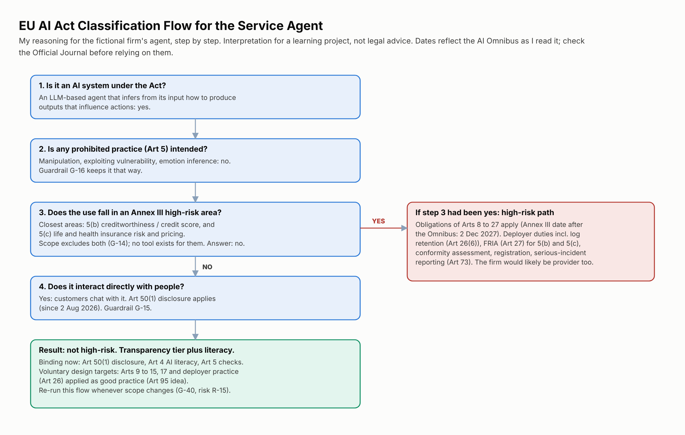

# 02: EU AI Act Classification

How I would classify the service agent under Regulation (EU) 2024/1689 (the EU AI Act), step by step, and what that means for the project. **This is my interpretation for a learning project, not legal advice.** A real classification would be made with legal counsel and recorded in the system register (G-40).

## Step 1: Is it an AI system?

An LLM-based agent that takes input and infers how to generate outputs (replies, tool calls) that influence what happens next is an AI system as the Act defines it. Yes.

## Step 2: Prohibited practices (Article 5)

Article 5 bans certain practices outright, including AI that uses manipulative techniques or exploits vulnerabilities to distort behaviour in harmful ways (Art 5(1)(a) and (b)). A customer-facing financial agent is a place where this could happen by accident (pressure, urgency, exploiting a customer's age, disability or financial situation, which Art 5(1)(b) names). So the project treats Article 5 as a design check, not a formality: G-16 forbids manipulation and, as a design heuristic, routes signs of vulnerability or distress to a person, and no emotion inference is used. Answer: no prohibited practice intended; keep checking.

## Step 3: Annex III high-risk areas

High-risk AI under Article 6(2) means the use cases listed in Annex III. The area closest to this system is **essential private services**: point 5(b) covers AI used to evaluate the creditworthiness of natural persons or establish their credit score (excluding fraud detection), and 5(c) covers risk assessment and pricing for life and health insurance. The service agent does neither: it answers questions, reads the customer's own records and performs bounded service actions. G-14 enforces the boundary with a classifier and, more importantly, with tool design: no tool exists that makes credit or insurance decisions. Answer: not Annex III, **as long as the scope holds**.

Article 6(3) lets a provider conclude that an Annex III system is not high-risk in narrow cases, but only after documenting the assessment, and it never applies to profiling of natural persons. The project does not rely on it.

## Step 4: Transparency (Article 50)

Article 50(1) requires providers to design AI systems that interact directly with people so that those people are told they are dealing with an AI system, unless that is obvious from the circumstances. A customer service chat is exactly that. This is the one new transparency obligation that clearly binds this system (Arts 4 and 5 also apply). Guardrail G-15 delivers it. Article 50 applies from 2 August 2026.

Article 50(2) (machine-readable marking of synthetic content) names audio, image, video **and text**. Whether it reaches individual replies in a service chat is, to my knowledge, an open interpretation question, so I flag it rather than answer it (see 03b).

## Result

| Question | Answer | Consequence |
|---|---|---|
| High-risk? | No, provided scope excludes Annex III 5(b) and 5(c) uses | Arts 8 to 27 are not binding obligations |
| Limited-risk (transparency)? | Yes | Art 50(1) applies now |
| Other binding duties? | Art 4 AI literacy; Art 5 prohibitions | G-43, G-16 |
| Voluntary design targets? | Yes | Arts 9 to 15, 17 and deployer practice are used as the design baseline |

**Why adopt high-risk requirements voluntarily?** Article 95 encourages voluntary application of such requirements. More practically, they are a good published method for risk management, logging, human oversight and robustness, and they are what the firm would need immediately if scope ever grew. Designing to that standard is cheaper than retrofitting.

## Key dates (as I understand them, check before relying)

| Date | What | Source of my understanding |
|---|---|---|
| 2 Feb 2025 | Art 4 AI literacy and Art 5 prohibitions apply (penalty provisions later, from 2 Aug 2025: to check) | AI Act application schedule |
| 27 Jul 2026 | AI Omnibus amending the Act in force (published in the Official Journal 24 Jul 2026; cited as Regulation (EU) 2026/1744 in one secondary source) | Law-firm summaries; I have not read the Official Journal text myself |
| 2 Aug 2026 | Art 50 transparency obligations apply | AI Act application schedule |
| 2 Dec 2026 | Grace period ends for Art 50(2) marking, only for generative systems placed on the market before 2 Aug 2026 (a new system gets none). The Omnibus also adds new Art 5 bans from this date (non-consensual intimate imagery and child sexual abuse material generators), which do not affect this system | Law-firm summaries of the Omnibus |
| 2 Dec 2027 | Annex III high-risk obligations apply (moved by the Omnibus) | Law-firm summaries of the Omnibus |
| 2 Aug 2028 | Annex I (product-linked) high-risk obligations apply | Law-firm summaries of the Omnibus |

## What would change the answer

| Change in scope | Effect | Guardrails and risk |
|---|---|---|
| Agent gives credit-limit increase or loan-eligibility guidance that feeds a decision | Likely Annex III 5(b): high-risk. Arts 8 to 27 apply; FRIA (Art 27) | G-14, G-40, R-15 |
| Agent prices or advises on life or health insurance | Annex III 5(c): high-risk | G-14, G-40, R-15 |
| Agent uses emotion inference on customers | Emotion recognition is high-risk under Annex III 1(c) with Art 50(3) disclosure; Art 5(1)(f) prohibits it only in workplace and education settings | G-16 |
| Agent moves money to new payees | Not an AI Act trigger by itself; large security and DORA impact | Tier table, G-06 |
| Firm stops building and buys a finished agent product | Roles follow the Art 3 definitions: the firm would be a deployer and the supplier the provider; Art 25 applies only if the firm puts its name on the product or substantially modifies it | G-26 |

## Adjacent regimes (not assessed in this project)

- **GDPR** applies to all the personal data in the system. The data-protection impact assessment, lawful basis, data-subject rights and the rules on solely automated decisions (Art 22) sit alongside the AI Act. G-42 includes a DPIA.
- **DORA** applies to the firm as a financial entity: ICT risk management, incident reporting, third-party risk (including the model and cloud providers).
- **NIS2** may apply depending on sector and size.
- **Consumer-protection and sector conduct rules** apply to what the agent says about products and fees (G-17).

## Open questions

- Does Art 50(2) marking apply to chat replies in a service channel?
- If the firm builds on a third-party general-purpose model, how do the model supplier's obligations and the firm's provider role fit together in practice (Art 25)?
- The Omnibus article-level text should be checked in the Official Journal before any of the dates above are used for planning.

## Sources

- Regulation (EU) 2024/1689 (EU AI Act), EUR-Lex: https://eur-lex.europa.eu/eli/reg/2024/1689/oj
- AI Omnibus: law-firm summaries (CMS, Goodwin); official text to be read from the Official Journal.

