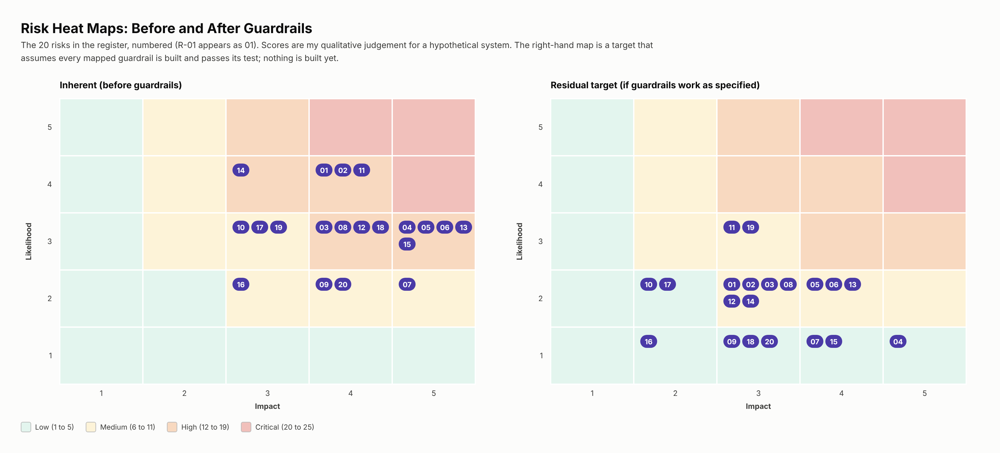

# 04: Risk Summary

20 risks: the ten from the OWASP Top 10 for Agentic Applications 2026 (a taxonomy, not a standard) plus ten I judged relevant to a customer-facing agent at a regulated firm. Scores are likelihood times impact on a 1 to 5 scale, **my own judgement for a hypothetical system**. The residual score is a **target** that assumes the guardrails are built and pass their tests. Nothing is built yet.

| ID | Risk | OWASP | Inherent | Residual (target) | Main guardrails |
|---|---|---|---|---|---|
| R-01 | Goal hijack by direct prompt injection | ASI01 | High | Medium | G-13, G-14, G-18 + |
| R-02 | Goal hijack by indirect injection | ASI01 | High | Medium | G-13, G-18, G-24 + |
| R-03 | Tool misuse inside granted permissions | ASI02 | High | Medium | G-06, G-07, G-08 + |
| R-04 | Cross-customer access through the agent (confused deputy) | ASI03 | High | Low | G-02, G-01, G-03 + |
| R-05 | Stolen or over-broad agent credentials | ASI03 | High | Medium | G-03, G-04, G-05 + |
| R-06 | Compromised model, tool server or prompt template | ASI04 | High | Medium | G-25, G-26, G-36 + |
| R-07 | Unexpected code execution | ASI05 | Medium | Low | G-11, G-12, G-08 + |
| R-08 | Memory or context poisoning | ASI06 | High | Medium | G-22, G-13, G-21 + |
| R-09 | Spoofed or manipulated inter-agent messages | ASI07 | Medium | Low | G-24, G-03, G-12 + |
| R-10 | Cascading failure, runaway loop or cost spike | ASI08 | Medium | Low | G-27, G-28, G-32 + |
| R-11 | Over-trust by customers or approvers | ASI09 | High | Medium | G-09, G-10, G-15 + |
| R-12 | Agent drift or rogue behaviour | ASI10 | High | Medium | G-29, G-31, G-32 + |
| R-13 | Personal or financial data leaks to the model provider, logs or replies | (OWASP LLM sensitive-information disclosure) | High | Medium | G-20, G-21, G-18 + |
| R-14 | Wrong financial information stated as fact | (hallucination) | High | Medium | G-17, G-35, G-34 + |
| R-15 | Scope creep into regulated decisions | (regulatory) | High | Low | G-14, G-40, G-41 + |
| R-16 | Missing or weak AI disclosure | (regulatory) | Medium | Low | G-15, G-36, G-35 |
| R-17 | Model provider outage or terms change | (resilience) | Medium | Low | G-28, G-26, G-38 + |
| R-18 | Insufficient evidence to reconstruct an incident | (governance) | High | Low | G-29, G-30, G-33 + |
| R-19 | Unfair or poor service for some customers | (fairness) | Medium | Medium | G-16, G-19, G-34 + |
| R-20 | Unauthorised production change | ASI10 | Medium | Low | G-05, G-36, G-29 + |

Inherent: 13 high, 7 medium. Residual target: 11 medium, 9 low.

The hardest risk to reduce with technology is R-11 (customers or staff over-trusting the agent). It depends on training and sampling, so its residual stays medium.

Full detail per risk (cause, components, scores, owner): [reference F](./reference/F-risk-register-detail.md). Guardrail details: [reference E](./reference/E-guardrails-specification.md).
