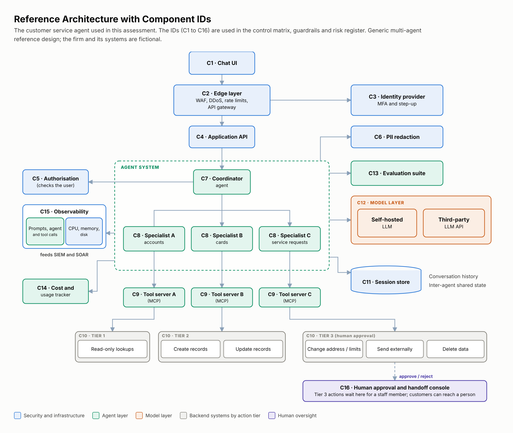

# Project 1: AI Governance Assessment for a Customer-Facing AI Agent

How would an AI agent system line up with **ISO/IEC 42001, the EU AI Act and the NIST AI RMF**, and how would you prove it?

## Summary

- **Problem:** AI agents act on their own (read data, call tools, change records), and none of the three frameworks was written with that in mind.
- **What I did:** designed the controls for a customer-service agent at a fictional EU-facing firm. I wrote 46 guardrails first, then mapped each to the frameworks and to the OWASP agent risks, with a reason for every exclusion.
- **What I found:** the agent is not high-risk under the EU AI Act as long as it never makes credit or insurance decisions, so that scope line is itself a compliance control. The controls that matter most (authorisation against the user, action tiers, human approval, audit logging) sit outside the model.
- **Not done:** building or testing it. Project 2 implements the core guardrails as tested code.

## Read in this order (about 10 minutes)

| # | File | What you get |
|---|---|---|
| 1 | [01-system-and-scope.md](./01-system-and-scope.md) | The system, what it may and may not do, one request end to end |
| 2 | [02-eu-ai-act-classification.md](./02-eu-ai-act-classification.md) | Why it is not high-risk, and what would change that |
| 3 | [03-core-control-matrix.md](./03-core-control-matrix.md) | The 12 core guardrails mapped to the three frameworks, plus coverage |
| 4 | [04-risk-summary.md](./04-risk-summary.md) | 20 risks with before and after heat maps |

Everything else is in [`reference/`](./reference): ISO 42001 applicability (all 38 Annex A controls), an optional ISO 27001 mapping appendix, EU AI Act and NIST AI RMF applicability tables, all guardrails with evidence and tests, and the full risk register. The same tables are in [`data/`](./data) as CSV.

## Results

| Measure | Result |
|---|---|
| Guardrails | 46, each with evidence and a test |
| ISO 42001 Annex A | 35 of 38 mapped; 2 organisation-level, 1 excluded with reason |
| NIST AI RMF | 64 of 72 mapped; 7 stated gaps |
| EU AI Act | Not high-risk if scope holds; Art 50(1) disclosure, Art 4 and Art 5 apply; Arts 9 to 15 adopted as design targets |
| Risk | Inherent 13 high, 7 medium; residual target 11 medium, 9 low |

Sources: ISO/IEC 42001:2023 (paid standard; see iso.org) · [EU AI Act](https://eur-lex.europa.eu/eli/reg/2024/1689/oj) · [NIST AI RMF](https://www.nist.gov/itl/ai-risk-management-framework) · [OWASP GenAI](https://genai.owasp.org/)

